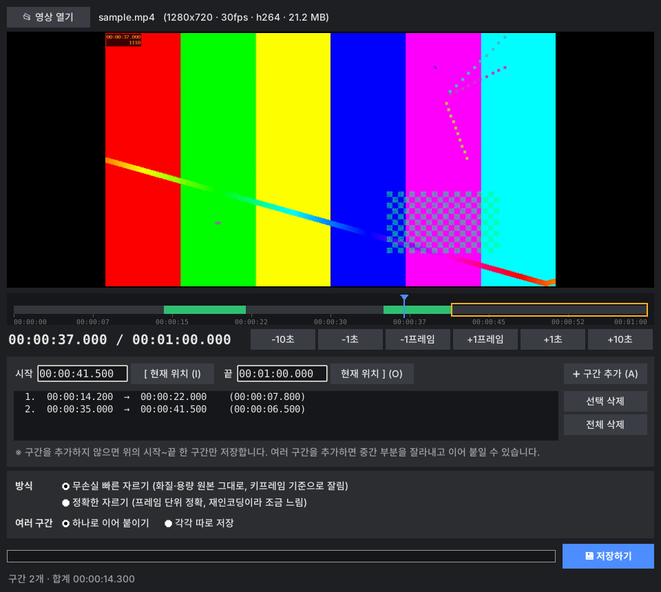

# MP4 Cutter

MP4 영상의 원하는 구간만 **무손실로** 빠르게 잘라내는 심플한 프로그램입니다.
재인코딩을 하지 않기 때문에 화질이 그대로이고, 잘라낸 길이만큼만 용량이 됩니다.
(Clipchamp 같은 편집기처럼 파일이 커지지 않습니다.)



## 🌐 웹에서 바로 사용

**https://samcheonghaus.github.io/mp4-cutter/**

설치 없이 브라우저(Chrome·Edge 권장)에서 바로 사용할 수 있습니다.
영상은 인터넷에 올라가지 않고 내 컴퓨터 브라우저 안에서만 처리됩니다.
(처음 저장할 때 처리 엔진 약 31MB를 한 번 내려받습니다)

## 사용법

**영상 끝 자르기** (가장 많이 쓰는 경우)
1. 영상 열기
2. 버릴 장면으로 이동 (타임라인 클릭)
3. **① 여기부터 버리기** 클릭
4. **저장하기**

**중간 부분 잘라내기**
1. 버릴 시작 장면에서 **① 여기부터 버리기**
2. 버릴 끝 장면에서 **② 여기까지 버리기**
3. **✂ 잘라내기** (여러 번 반복 가능)
4. **저장하기** → 남은 부분이 이어 붙여진 새 파일이 만들어집니다

타임라인: 초록 = 남는 부분, 빨강 = 잘라낸 부분, 주황 = 지금 선택한 버릴 부분.
원본 파일은 바뀌지 않고 `파일명_cut01.mp4` 로 새로 저장됩니다.

**방식**
- **빠르게** (기본): 재인코딩 없이 몇 초 만에 저장, 화질·용량 원본 그대로. 자른 위치가 1초 정도 어긋날 수 있음
- **정확하게**: 프레임 단위 정확, H.264로 다시 인코딩 (조금 느림)

exe 아이콘 위에 영상 파일을 끌어다 놓으면 바로 열립니다.

## 단축키

| 키 | 동작 |
|---|---|
| ← / → | 1초 이동 |
| Shift + ← / → | 1프레임 이동 |
| PgUp / PgDn | 10초 이동 |
| Home / End | 처음 / 끝 |
| S | 여기부터 버리기 |
| E | 여기까지 버리기 |
| X | 잘라내기 |
| Ctrl+O / Ctrl+S | 열기 / 저장 |

## 💻 Windows 프로그램 다운로드

[Releases](../../releases) 에서 `MP4Cutter.exe` 를 받아 실행하면 됩니다. (ffmpeg 포함, 설치 불필요)

> 처음 실행 시 Windows SmartScreen 경고가 나오면 "추가 정보 → 실행"을 누르세요. (서명되지 않은 개인 프로그램이라 나오는 경고입니다)

## Python으로 실행 (Windows / Mac / Linux)

```bash
pip install -r requirements.txt
python mp4cutter.py
```

Windows에서는 `run.bat` 더블클릭으로도 실행됩니다.

## exe 빌드

GitHub에 올리면 `.github/workflows/build.yml` 이 자동으로 Windows exe를 만듭니다.

- **Actions 탭** → 최신 실행 → 아래 Artifacts 에서 `MP4Cutter-windows` 다운로드
- 또는 **Releases → Draft a new release** 로 태그(예: `v1.0.0`)를 만들어 발행하면 exe가 Release에 자동 첨부됩니다.

직접 빌드하려면:

```bash
pip install -r requirements.txt pyinstaller
python -c "import imageio_ffmpeg, shutil; shutil.copy(imageio_ffmpeg.get_ffmpeg_exe(), 'ffmpeg.exe')"
pyinstaller --onefile --windowed --name MP4Cutter --add-binary "ffmpeg.exe;." mp4cutter.py
```

## 라이선스

MIT. Windows 빌드에는 ffmpeg(GPL)가 포함됩니다.
